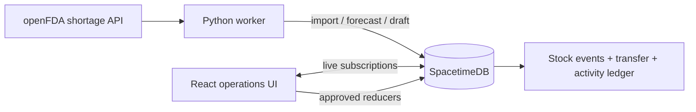

# Argus Supply Network

Argus is a working, local multi-site drug shortage coordination app. It combines the **real FDA drug shortage feed** with **inventory counts entered by a pharmacy team** in SpacetimeDB. It estimates days of supply, drafts possible inter-site transfers, and keeps a human in control of every stock movement.

The app has five focused screens: Overview, Inventory, Transfers, FDA watch, and Network. It starts with **zero invented inventory**. This is an operations prototype for non-patient data, not a clinical decision system or a production hospital deployment.

## Run it

Prerequisites: Node.js 22+, Python 3.10+, SpacetimeDB CLI 2.14.1, and internet access to `api.fda.gov` for FDA updates. From this repository:

```bash
npm ci
npm run demo
```

The script starts or reuses local SpacetimeDB on port 3000, safely publishes database `argus-supply` without deleting data, starts the Python worker, and serves the web app on the first free port from 5173. Read the URL and **worker identity** printed in the terminal. Existing `argus` data from the former project is untouched.

1. Open the printed dashboard URL. If the network is new, enter your name and first site to become its admin. If it already exists, ask its admin to grant your browser identity.
2. Open **Network**. Add sites and grant the printed worker identity the **service** role. The worker then imports the complete FDA feed and runs the forecast/transfer agent. An admin can also use **FDA watch → Sync FDA now**.
3. In **Inventory**, enter a real package NDC, product name, counted on-hand quantity, unit, typical daily use, and safety stock. FDA matches require an exact package NDC or explicit confirmation.
4. Record usage and receipts. The worker recomputes estimates from the count, baseline, and recorded usage.
5. In **Transfers**, review agent drafts or create a request. The destination requests; the source reserves and ships; the destination confirms receipt.

Run `npm run worker:identity` to print the persisted service identity again. The worker token is stored at `.argus-supply/service.json`, ignored by Git. Keep it private. `npm run worker:once` runs one cycle; `npm run worker` runs continuously. `npm run build`, `npm run typecheck`, and `npm test` check the web app and worker. The launch script writes per-run logs under `logs/`.

## What is real

| Information | Source | Meaning |
|---|---|---|
| FDA notices | [openFDA drug shortage API](https://open.fda.gov/apis/drug/drugshortages/) | Public national supply signal, with source update date, status, company, presentation, NDC, and optional RxCUI |
| On-hand inventory | A site manager's count | Operational stock recorded in the SpacetimeDB ledger; never inferred from the FDA feed |
| Usage | Recorded stock movements and manager baseline | Input to the demand estimate |
| Forecast | Python Gamma-Poisson model | Demand uncertainty around days of unreserved stock; not a delivery promise |
| Transfer draft | Bounded agent rule | A reviewable suggestion when one site is critical and another has surplus |
| Transfer state | Human actions in SpacetimeDB reducers | The authoritative request, reservation, shipment, and receipt ledger |

There is no public API for a hospital's live shelf count. A hospital must provide that through an approved inventory integration or through the manual entry workflow here. Public FDA data cannot substitute for local stock. Package NDC matching also needs human review for changes in package, strength, or formulary item.

## System at a glance



SpacetimeDB is the **single authoritative state machine**. Reducers atomically enforce roles and inventory invariants. Browser clients subscribe over WebSocket; the worker uses HTTP SQL and reducer calls under a separate service identity. The worker may import public notices and write derived forecasts/drafts. It cannot approve, ship, or receive stock. Transfer approval reserves quantity before it is deducted on shipment, preventing two managers from allocating the same free units. Forecast writes include the inventory revision and are rejected if their input became stale.

The running app loads `web/src/supply`, the generated bindings in `web/src/supply_bindings`, the module in `server/src/index.ts`, and `worker/argus_supply.py`.

## Documentation

- [Architecture and distributed systems](docs/ARCHITECTURE.md)
- [Data sources, model, and agent](docs/DATA_AND_INFERENCE.md)
- [Operations and troubleshooting](docs/OPERATIONS.md)
- [Security and deployment boundary](docs/SECURITY.md)
- [Verification and test procedure](docs/TESTING.md)

## Important boundary

This app has functioning local data flows and real FDA data, but it is **not ready for a hospital production network**. Public SpacetimeDB tables can be queried by connected clients; UI role gating does not provide confidential read access. No patient information, controlled credentials, or sensitive facility data should be entered. Production use needs server-side visibility controls, institution identity integration, TLS, backups, monitored hosting, audit retention, and clinical/operational validation. See [Security](docs/SECURITY.md).
