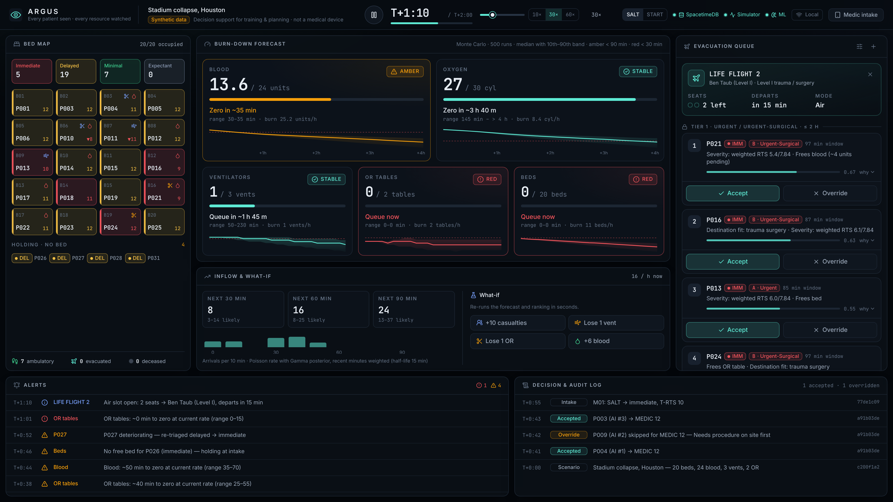
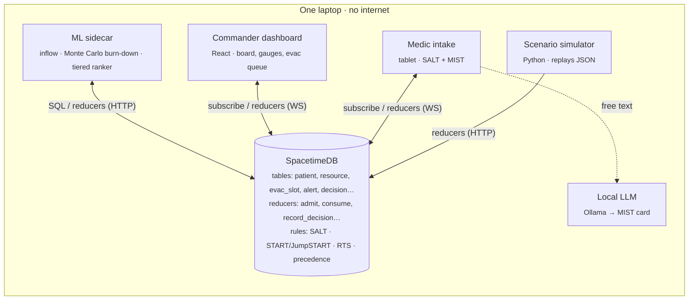

<div align="center">


# Argus

**Every patient seen, every resource watched.**

Offline AI command dashboard for mass-casualty events. It forecasts which resource runs out first, raises an alert before it hits zero, and suggests who to evacuate next. A human makes every decision.

`SpacetimeDB` · `TypeScript module` · `React + Vite + Tailwind + Recharts` · `Python ML sidecar` · `local LLM`

</div>



> **Synthetic data only.** This is decision support for training and planning, not a medical device. All scenario figures are illustrative placeholders, and every protocol threshold has to be checked against its source document before anyone relies on it.

---

## What it does

Existing bed boards show what is open right now. Argus works more like air-traffic control for casualties: it sees what is inbound and what is burning down, and it suggests an order for departures so nothing collides.

| | |
|---|---|
| **Scenario simulator** | Replays a scripted 40-casualty event in three waves, with a 1–120× speed slider and pause |
| **Live resource board** | Beds, blood, O₂, ventilators and OR tables update every simulated minute |
| **Burn-down forecast** | Monte Carlo (500 runs) time-to-zero per resource, shown as a median with a 10th–90th percentile band. Amber under 90 min, red under 30 min |
| **Evacuation ranking** | Top 5 candidates per slot. MEDEVAC precedence tier comes first as a hard rule, then a transparent score orders patients within each tier. Each candidate shows the two factors that set them apart |
| **Handoff assistant** | Free text or voice goes to a local LLM (Ollama), which produces a MIST card and a draft 9-line. A rule-based parser takes over if the model is unavailable |
| **What-if panel** | "+10 casualties", "Lose 1 vent", "Lose 1 OR". The forecast and ranking rerun within seconds |
| **Override + audit log** | Every accept and override is recorded with time, actor and a one-tap reason |
| **Two-device sync** | The medic tablet and the commander laptop share state through SpacetimeDB subscriptions over local Wi-Fi |

## Architecture

SpacetimeDB is the single source of truth. Every device and model reads by subscribing to its tables and writes only through reducers.



- **Protocol rules run inside the module as deterministic code** (`server/src/protocols`). The dashboard imports the same files to preview triage, so there is only one implementation.
- **The ML sidecar only forecasts and orders within tiers.** The module checks the tier rule again in `write_ranking`, so a buggy model cannot place a Priority patient above an Urgent one.
- **No recommendation applies itself.** Patients are evacuated only through `record_decision`, which a person has to trigger.

## Quick start

Prerequisites: **Node 22+**, **Python 3.10+**, and the **SpacetimeDB CLI**. Install the CLI once while you have internet:

```bash
curl -sSf https://install.spacetimedb.com | sh
```

Then start everything:

```bash
npm run demo            # or: scripts/start-demo.sh forward
```

That single command:

1. starts a local SpacetimeDB on `:3000`,
2. publishes the module as database `argus`,
3. starts the ML sidecar and the scenario simulator (paused),
4. serves the dashboard at **http://localhost:5173**.

Press **▶** in the top bar to start. Open **http://&lt;laptop-ip&gt;:5173/#/intake** on a tablet connected to the same Wi-Fi to use the medic view. The first run installs dependencies. After that, nothing needs the network.

**Optional: local LLM for the handoff assistant**

```bash
ollama pull llama3.2:3b     # any small instruct model works; set VITE_OLLAMA_MODEL to change it
```

If Ollama isn't running, the intake view says so and uses the deterministic parser instead. The demo never depends on the model.

<details>
<summary><b>Run the pieces by hand</b></summary>

```bash
spacetime start                                     # terminal 1
cd server && npm run publish:local                  # once per module change
cd ml && python -m venv .venv && .venv/bin/pip install -e ".[dev]"
.venv/bin/python -m argus_ml.sidecar                # terminal 2
.venv/bin/python -m argus_ml.simulator ../scenarios/stadium_collapse.json   # terminal 3
npm run dev                                         # terminal 4 (repo root)
```

After you change tables or reducers, regenerate the client bindings:

```bash
npm run generate
```

</details>

## Demo script (4 minutes)

| Time | Beat | What happens on screen |
|---|---|---|
| 0:00 | **Hook** | "In a mass-casualty event, the commander finds out blood ran out when someone asks for a unit that isn't there." |
| 0:30 | **Pull the Wi-Fi** | The top-bar badge changes to **Offline · local only** and stays that way. |
| 0:40 | **Intake** | A teammate reads a casualty report into the tablet. The MIST card fills in, SALT assigns **Immediate**, RTS is computed, and the patient appears on the laptop instantly. |
| 1:10 | **Surge** | Speed goes to 30× and wave two hits. Around **T+0:45** the blood gauge turns amber: *"~50 min to zero (range 35–70)"*. |
| 2:00 | **Evac decision** | At **T+1:10**, *LIFE FLIGHT 2* opens with 2 seats. Urgent patients are listed first, then ranked within their tier, each with two reasons. Accept one. Override another with a reason. Both go into the audit log. |
| 2:50 | **What-if** | Press "Lose 1 vent". The forecast and ranking update within seconds. |
| 3:30 | **Close** | "It never decides. It makes sure the human decides an hour earlier." |

The stadium scenario uses seed 37, chosen so these beats land: blood first turns amber at T+0:40, and if nobody is evacuated it runs out at about T+1:42. Check this offline with `cd ml && .venv/bin/python -m argus_ml.offline ../scenarios/stadium_collapse.json`.

## Clinical core

| Decision | Established method | How Argus uses it |
|---|---|---|
| Initial triage | **SALT**: Sort, Assess, Lifesaving interventions, Treatment/Transport | The intake form follows SALT step by step. Live resource levels are shown next to "likely to survive given current resources?" |
| Alternate triage | **START / JumpSTART** | A top-bar toggle switches protocols. Under START, children under 8 are routed to JumpSTART automatically |
| Severity | **Revised Trauma Score** | T-RTS (0–12) is shown on every card. Weighted RTS feeds the deterioration risk |
| Evac category | **MEDEVAC precedence** (A Urgent, B Urgent-Surgical, C Priority, D Routine, E Convenience) | Hard tiers. The ranker only orders patients inside a tier and counts down each patient's window |
| Handoff | **MIST** + 9-line lines 3/4 | The LLM only structures and summarises what the medic said. It never scores, ranks or recommends |

Guardrails are written into the code and covered by tests. Argus **never assigns Expectant automatically**: only a medic's explicit answer can. Re-triage can escalate a category but never downgrades it, and it never overrides a category a medic set. Expectant and Dead patients are never ranked for evacuation automatically.

## ML engines

| Engine | Method | Output |
|---|---|---|
| Inflow forecaster | Poisson rate with a Gamma posterior; recent arrivals weighted more heavily (15-min half-life) | Expected arrivals in the next 30/60/90 min, with an 80% range |
| Resource burn-down | Monte Carlo, 500 runs over arrival rate, category mix (Dirichlet) and per-patient use. Usage starts from a prior and is updated with what the incident has actually consumed | Median time-to-zero, a p10–p90 band, and the projected availability curve |
| Evacuation ranker | `EvacScore = w₁·DeteriorationRisk + w₂·ResourceRelief + w₃·DestinationMatch`, with weights on dashboard sliders | Top 5 per slot. The reason shows the two factors that most distinguish the patient from others in the same tier |
| Handoff assistant | Small open-weight model through Ollama, using a fixed JSON schema and a few-shot example. A deterministic regex parser is the fallback | MIST card and draft 9-line, confirmed by the medic |

## Repository layout

```
server/            SpacetimeDB TypeScript module
  src/index.ts       tables + reducers (the only write path)
  src/protocols/     SALT, START/JumpSTART, RTS, precedence, catalogue — pure + tested
web/               React dashboard (commander view + #/intake medic view)
  src/module_bindings/   generated client bindings (`npm run generate`)
  src/lib/handoff.ts     local-LLM MIST assistant + rule-based fallback
ml/                Python sidecar + simulator (numpy only)
  argus_ml/inflow.py · burndown.py · ranker.py · sidecar.py · simulator.py · scenario.py
scenarios/         reproducible scenario scripts (generated by `argus_ml.scenario`)
scripts/           start-demo.sh — one-command launcher
```

## Tests

```bash
npm test                                   # protocol rules (29) + handoff parser (5)
cd ml && .venv/bin/pytest -q               # forecaster, burn-down, ranker, scenarios (15)
npm run typecheck                          # module + dashboard
```

The protocol tests encode the published decision trees, which gives the clinical lead a concrete checklist to sign off against the source documents.

## Roadmap

1. **Validate.** Show the demo to EMS educators, trauma surgeons and disaster-preparedness staff. Find out which protocol they use.
2. **Training simulator.** Scenario replay plus drill scoring that compares trainee choices with the ranking.
3. **Pilot.** Run Argus alongside a hospital surge drill or a county MCI exercise.
4. **Defence path.** Add security hardening and test on edge hardware.

Deploying this for real would need clinical validation and a regulatory review before use with any patient.
