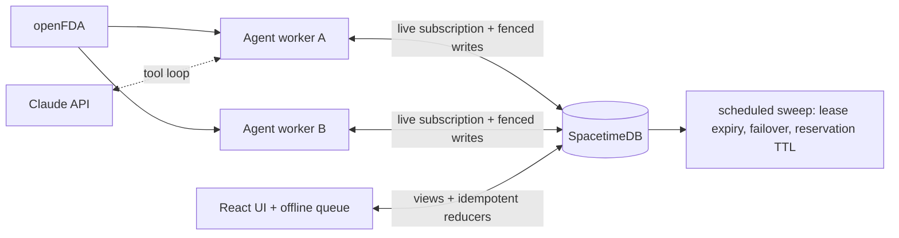

# Argus Supply Network

Argus is a working, local multi-site drug-shortage coordination system. It combines the **real FDA drug shortage feed** with **inventory counts entered by pharmacy teams**, predicts which sites will run out before resupply, and drafts transfers between sites for people to approve. It is built on three ideas:

- **Distributed:** a pool of agent workers shares the network through leased, fenced work assignments with automatic failover, and browsers keep working offline with idempotent replay.
- **Inference:** a Gamma–Poisson demand model gives a *probability of stocking out before resupply*. It stretches lead times for items in an active FDA shortage, pools priors across sites, and checks its own calibration with rolling backtests.
- **Agentic:** a planning agent (Claude, with a deterministic fallback) reads the whole network through tools, drafts multi-source transfers within hard surplus limits, and suggests FDA links. Every step is traced. It cannot move stock.

The app never invents inventory in a real network. A separate, clearly labeled **sandbox** network shows the full system with synthetic data built around real FDA notices. This is an operations prototype for non-patient data, not a clinical decision system or production hospital deployment.

## Run it

Prerequisites: Node.js 22+, SpacetimeDB CLI 2.14.1, and internet access to `api.fda.gov`.

```bash
npm ci
npm run sandbox   # synthetic sites + real FDA notices: see everything working in a minute
npm run demo      # your real network (argus-supply): starts empty, you enter counts
```

Each command starts or reuses SpacetimeDB on port 3000, publishes its database without deleting data, starts **two agent workers** (`ARGUS_WORKERS=N` for more), and serves the dashboard on the first free port from 5173.

- **Sandbox:** open the URL, click **Join sandbox as admin**, and data appears as the seeder finishes.
- **Real network:** create the network with your name, email, and password (you become admin), then click **Activate workers**. Add sites and people in **Network**, and real counts in **Inventory** (one at a time, **Record usage** for daily entry, or **Import CSV**).

**Try failover:** kill one worker's PID (printed at startup) and watch **System → Leases** move to the survivor within about 10 s, each with a new epoch.

**Claude agent:** with `ANTHROPIC_API_KEY` set, the agent runs on `claude-opus-5-5` with server-side refusal fallbacks enabled (`fallbacks: "default"`). Without a key it uses the deterministic planner. Set `ARGUS_AGENT_MODE=rules|llm|auto` to choose.

**Checks:**

```bash
npm run typecheck
npm test                  # unit tests
npm run build
npm run test:integration  # end-to-end on a disposable DB
```

The integration test needs SpacetimeDB running.

## Screens

| Screen | Tabs | What it does |
|---|---|---|
| Home | — | At-risk products ranked by chance of running out, drafts to review, the agent's latest conclusion, forecast accuracy |
| Inventory | Stock · Record usage · Import CSV | Search with suggestions (and need-based recommendations when empty), counts, forecast per product, record usage/deliveries, bulk daily entry, CSV import with preview |
| Transfers | Agent drafts · In progress · History | Review drafts, then request → reserve → ship → receive |
| Agent | Runs · FDA link review | Ask the agent a question, read its conclusion (steps hidden behind a toggle), confirm suggested FDA links |
| FDA watch | Current shortages · All notices | Search the FDA list with suggestions; "Track at a site" |
| Network | Sites · People · Workers | Sites, accounts (create, edit role/site, reset password, remove), worker identities |
| System | Status · Settings | Which worker runs which job; settings for shortage resupply stretch, reservation expiry, auto-run, and Claude on/off |

## What is real

| Information | Source | Meaning |
|---|---|---|
| FDA notices | [openFDA drug shortage API](https://open.fda.gov/apis/drug/drugshortages/) | National supply signal; never treated as local stock |
| On-hand inventory | A site manager's count (real network) or the seeder (sandbox only) | The ledger in SpacetimeDB |
| Forecast | Gamma–Poisson posterior and resupply simulation | Demand and resupply uncertainty, not a delivery promise |
| Transfer drafts / FDA matches | Agent run (Claude or deterministic) | Suggestions only; a person decides |
| Transfer state | Human reducer calls | The authoritative request, reservation, shipment, and receipt ledger |

## System at a glance



The code is in `server/src/index.ts` (module), `agent/src` (workers, model, planner, Claude loop, sandbox seeder), `web/src/supply` (UI), and `web/src/supply_bindings` (generated; run `npm run generate` after schema changes).

## Documentation

- [Architecture and distributed systems](docs/ARCHITECTURE.md)
- [Data, inference, and the agent](docs/DATA_AND_INFERENCE.md)
- [Operations and troubleshooting](docs/OPERATIONS.md)
- [Security boundary](docs/SECURITY.md)
- [Verification](docs/TESTING.md)

## Important boundary

People sign in with email and password (hashed in the database, lockout after 5 failures), and data is readable only by signed-in members. This is still a local prototype: no institutional SSO, TLS, backups, or database high availability. Do not enter patient information or confidential facility data. See [Security](docs/SECURITY.md).
